<div align="center">
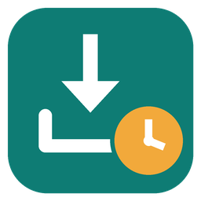

# Downloads Lifecycle

**Downloads as an inbox: every file knows its site, leftovers go safely to the Recycle Bin.**

**English** · [Русский](README.ru.md)

[](https://github.com/lojekq/DownloadsLifecycle/releases/latest)
[](https://github.com/lojekq/DownloadsLifecycle/releases)
[](https://github.com/lojekq/DownloadsLifecycle/actions/workflows/ci.yml)

[](LICENSE)

<picture>
  <source media="(prefers-color-scheme: dark)" srcset="docs/inbox-dark-en.png">
  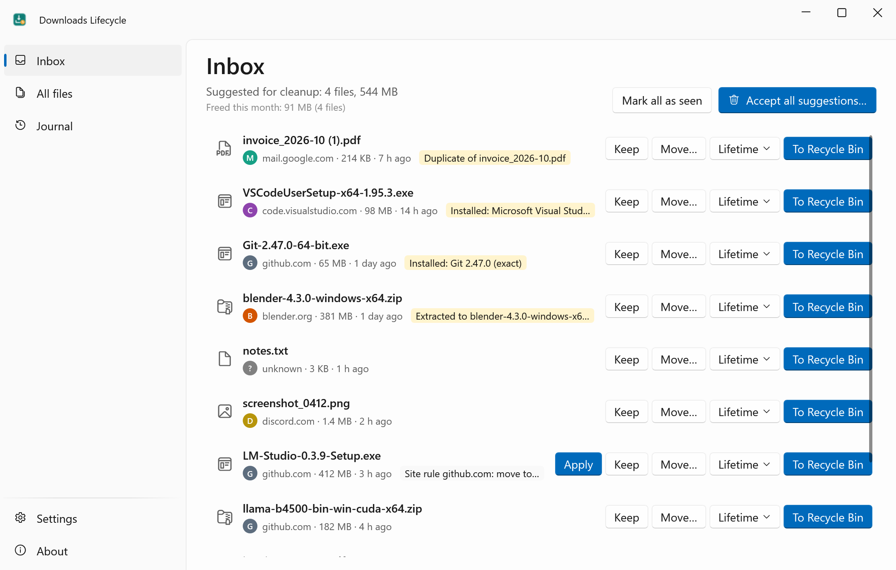
</picture>
</div>

## Why

The Downloads folder grows forever: installers you ran months ago, archives you already extracted, `invoice (1).pdf` next to `invoice.pdf`.
Downloads Lifecycle turns it into an inbox: it remembers where each file came from, spots what is no longer needed and lets you clear it in one go.
Nothing is ever deleted for good: every file goes to the Recycle Bin, and every action is in the journal.

## Features

- **Every file shows the site it came from** — search and group by site, with the full page and file address one click away.
- **Leftovers are spotted for you** — installers of programs you already have, archives you already extracted, duplicates (the same size and contents, whatever the name).
- **Lifetime** — right-click → "Lifetime → 7 days": the file goes to the Recycle Bin when its time is up.
- **Site rules** — "github.com + exe, msi → move to D:\Installers", "huggingface.co → 30 days": automatic, or one Apply click in the inbox.
- **More than zip** — .7z, .rar and .tar.* archives are checked too; Telegram Desktop or any other folder can be watched like Downloads.
- **Restore and "Where is it from?"** — the journal brings files back from the Recycle Bin; right-click any file to see its site and addresses.
- **One daily screen** — new downloads and suggestions in one place: Keep, Move, To Recycle Bin or Lifetime, with keys K / M / Del / T.
- **Safe by design** — Recycle Bin only, 8 s to undo, every action logged, every auto-rule is off until you turn it on.
- **100 % local** — no admin rights, no telemetry, no browser history reading.

## See it in action

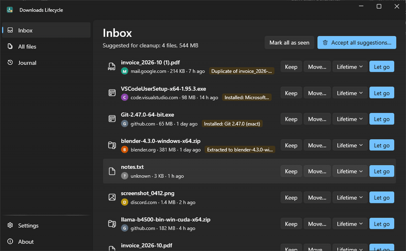

## Screenshots

| | Light | Dark |
|---|---|---|
| All files, grouped by site | 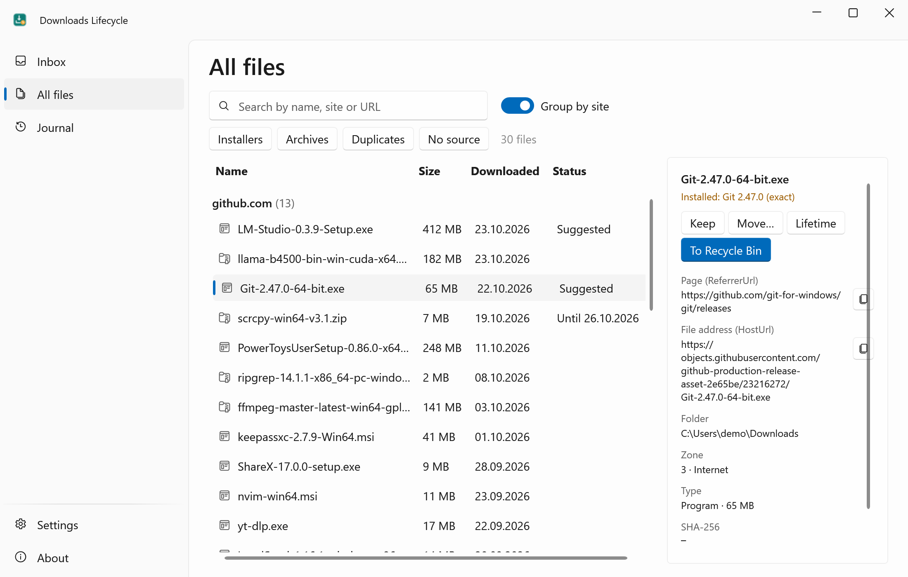 | 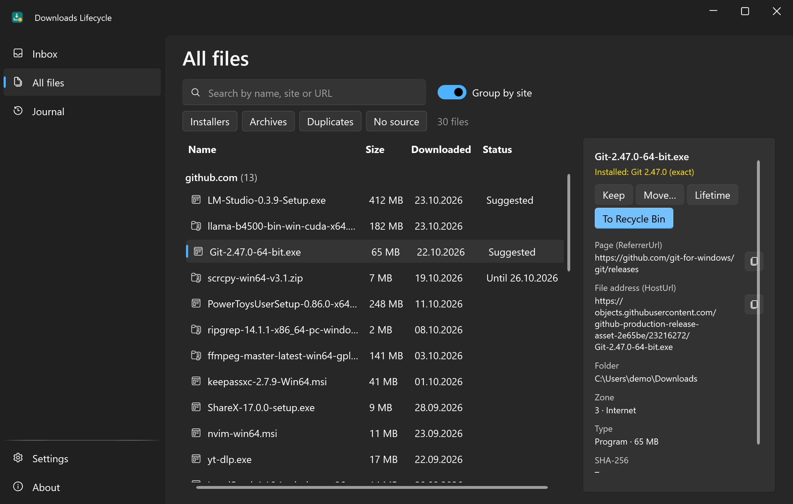 |
| Journal | 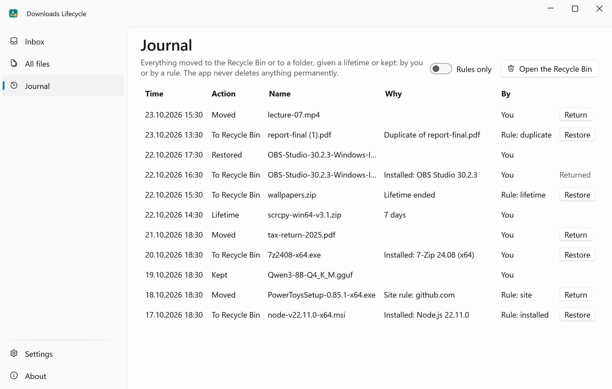 | 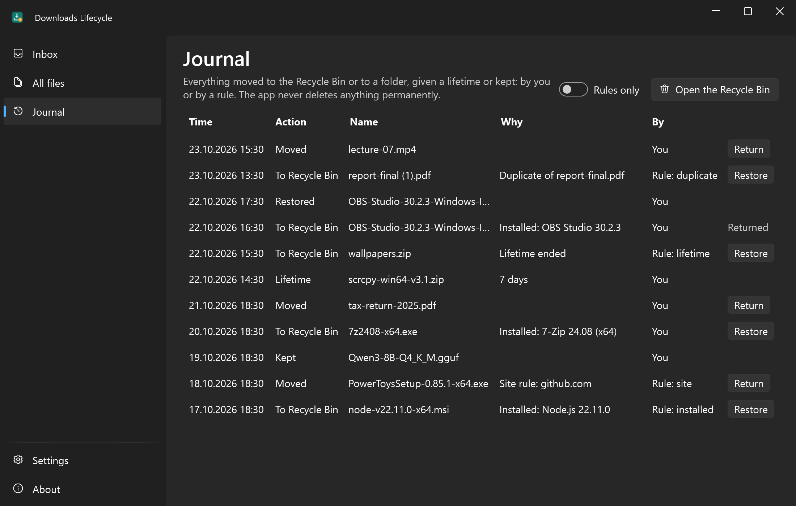 |
| Folders and site rules | 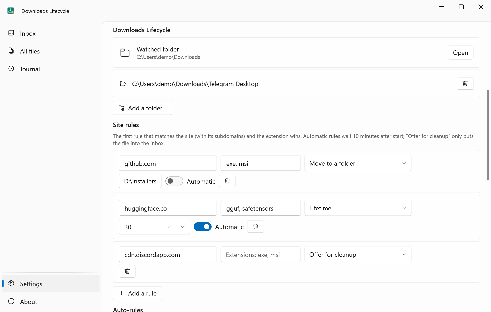 | 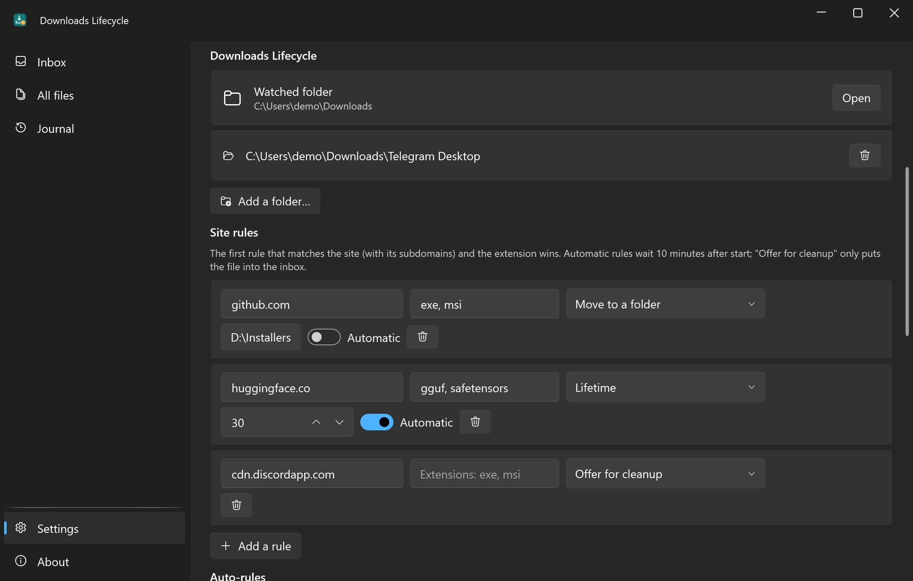 |
| Auto-rules and safety | 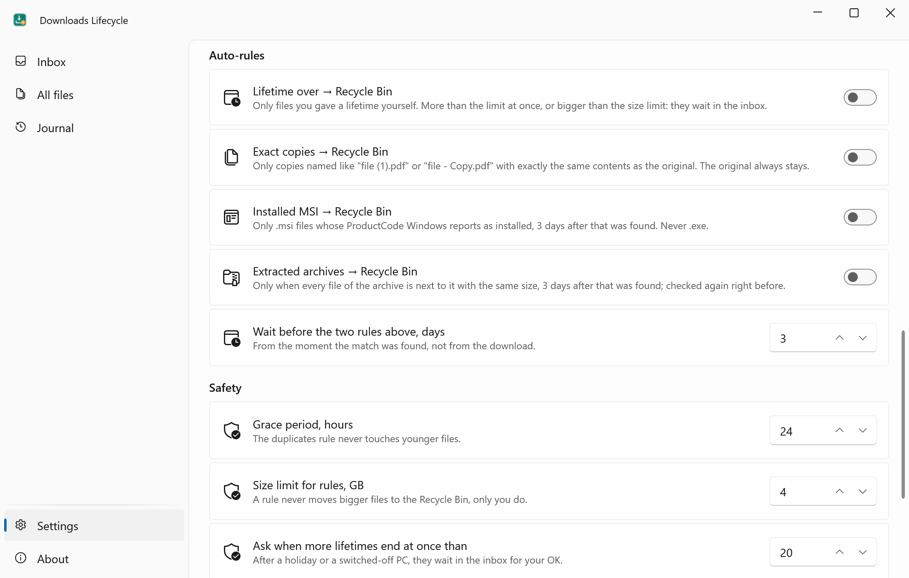 | 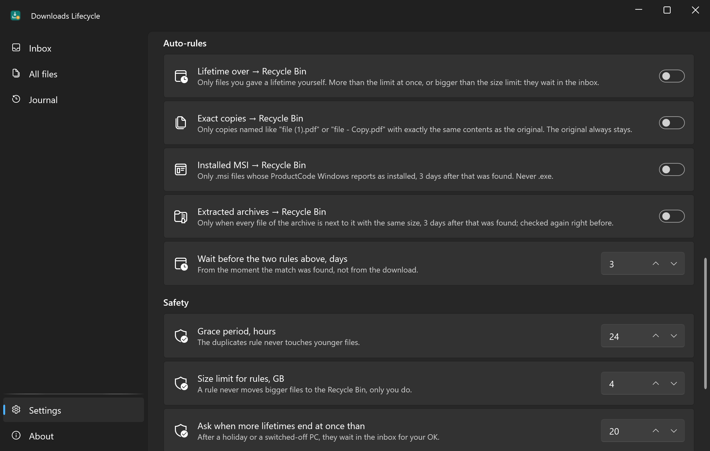 |

## How it works

When a browser saves a file, Windows attaches a hidden Mark-of-the-Web stream (`Zone.Identifier`) with the page and file address.
Downloads Lifecycle only reads it, once, when the file appears, so the source survives "Unblock". Installers are matched against the list of installed programs
(an `.msi` exactly by its ProductCode), archives (`.zip`, `.7z`, `.rar`, `.tar.*`, only their lists of files) against the files next to them,
duplicates by size, then SHA-256 (the name never decides). All of it happens on your PC.

## Download

1. **[Download DownloadsLifecycle.exe](https://github.com/lojekq/DownloadsLifecycle/releases/latest/download/DownloadsLifecycle.exe)** (latest release). One file, no admin rights.
2. Smaller build: [`DownloadsLifecycle-fd.zip`](https://github.com/lojekq/DownloadsLifecycle/releases/latest/download/DownloadsLifecycle-fd.zip) (needs [.NET Desktop Runtime 10](https://dotnet.microsoft.com/download/dotnet/10.0)).
3. Optional check: `gh attestation verify <file> -R lojekq/DownloadsLifecycle` or compare with `SHA256SUMS.txt`.

Requirements: Windows 11 x64. Windows 10 22H2 should work but is not tested.

## First run

Run the downloaded exe from anywhere. Windows may show a SmartScreen warning first (see FAQ).
The app offers to install itself: **Install** copies it to `%LOCALAPPDATA%\Programs\DownloadsLifecycle\`, adds the right-click menu, a Start menu shortcut,
autostart (for the daily reminder) and an entry in Settings → Apps; no admin rights. **Run without installing** keeps it portable.
To update, run a newer exe the same way: it replaces the installed one and restarts it. The first screen shows how many files are there and offers the two simplest auto-rules, both off.

## Settings

| Setting | Default | What it does |
|---|---|---|
| Lifetime over → Recycle Bin | off | Files whose lifetime you set yourself go to the Recycle Bin when it ends |
| Exact copies → Recycle Bin | off | Only `file (1).pdf` / `file - Copy.pdf` with the same contents as the original; the original stays |
| Installed MSI → Recycle Bin | off | Only `.msi` files whose ProductCode Windows reports as installed; never `.exe` |
| Extracted archives → Recycle Bin | off | Only when every file of the archive is next to it with the same size; checked again right before |
| Wait before the two rules above | 3 days | Counted from the moment the match was found |
| Site rules | none | Site (with subdomains) + extensions → lifetime, move to a folder, or offer for cleanup; automatic or with Apply |
| Extra folders | none | Watched like Downloads, e.g. `Downloads\Telegram Desktop` |
| Grace period | 24 h | The duplicates rule never touches younger files |
| Size limit for rules | 4 GB | A rule never moves bigger files to the Recycle Bin, only you do |
| Ask when more lifetimes end at once than | 20 | After a holiday they wait in the inbox for your OK |
| Daily reminder | on, 19:00 | "Inbox: 12 files, 3.4 GB to clean"; not during a fullscreen game or presentation |
| "Lifetime" in the right-click menu | on after install | In Windows 11 it is under **Show more options** (Shift+F10) |
| Start with Windows, Start menu shortcut | on after install | Starts minimized to the tray; a shortcut in the Start menu |
| Installation | — | Install, or Uninstall when installed |
| Language, theme, updates | Windows / on | The usual |

Settings, the index (`state.json`) and the journal (`journal.jsonl`) live in `%APPDATA%\DownloadsLifecycle`.

## Safety

- Only the Recycle Bin, never a permanent delete. If a file cannot go there (too big, a network drive), Windows asks first; removable and network drives are not touched at all.
- Before every action the file is checked again: same file, same size and date, not open in another program. Anything else cancels the action.
- An `.exe` that matches no installed program is never offered: it may be a portable app.
- Moving to another drive copies, verifies and only then sends the original to the Recycle Bin; moves can be returned from the journal.
- Rules wait 10 minutes after start, can be paused from the tray, and skip files bigger than the limit.
- A rule moves installers and archives to the Recycle Bin only on an exact match (MSI by ProductCode, archive at 100 %), days after it was found, and checked again right before.
- If Windows Storage Sense also clears Downloads, Settings warns you: those files skip the Recycle Bin and the journal.

## FAQ

<details><summary>Windows protected your PC / SmartScreen warning</summary>

The exe is not code-signed yet, so Windows does not know the publisher. Click **More info → Run anyway**.
Every file is built by GitHub Actions from this repository; you can check it with `gh attestation verify` or `SHA256SUMS.txt`.
Smart App Control, if it is on, blocks unsigned files with no way to allow one; the only option is to turn it off.
</details>

<details><summary>My antivirus flags it</summary>

It is a false positive: the app has no packer and no obfuscation, installs only into your user folder and moves files to the Recycle Bin only when you ask.
Please report it to your antivirus vendor and open an issue with the detection name and the SHA256 of the file.
</details>

<details><summary>I don't see "Lifetime" when I right-click a file</summary>

Windows 11 shows menu items of classic apps under **Show more options** (or Shift+F10). The item appears by itself only when the exe
is installed; otherwise turn it on in Settings. Lifetime works for files in Downloads only.
</details>

<details><summary>Why is the source "unknown"?</summary>

The site is known only if the browser wrote Mark-of-the-Web: private/incognito windows, Telegram, files copied from a USB stick or
a non-NTFS drive, and files unblocked before the app first saw them have none. Everything else still works for them.
</details>

<details><summary>A file went to the Recycle Bin by mistake</summary>

Journal → **Restore**: it goes back to where it was (if that place is free). Moves have **Return**.
Once a file is back, or was deleted from the Recycle Bin for good, its row says so instead of showing the button.
</details>

<details><summary>How do I uninstall?</summary>

Settings → **Uninstall**, or Windows Settings → Apps → Downloads Lifecycle → Uninstall. It removes the right-click menu too; you choose whether settings, the index and the journal go as well.
Without installing: About → **Remove data and autostart**, then delete the exe.
</details>

## Privacy

No telemetry. The only network request is the update check: `GET https://api.github.com/repos/lojekq/DownloadsLifecycle/releases/latest` once a day; turn it off in Settings.
Locally the app reads the top level of Downloads, the `Zone.Identifier` streams of those files, the list of installed programs and `.msi` files (read-only).
It writes only to `%APPDATA%\DownloadsLifecycle` and its own right-click menu keys; logs contain no file names, paths or URLs.

## Build from source

```powershell
winget install Microsoft.DotNet.SDK.10
git clone https://github.com/lojekq/DownloadsLifecycle
cd DownloadsLifecycle
dotnet run --project src/DownloadsLifecycle -- --watch-dir C:\Demo\Downloads
dotnet test
```

A Debug build never touches your real Downloads: it watches `C:\Demo\Downloads` or the folder given with `--watch-dir`.

## License

MIT © 2026 lojekq
