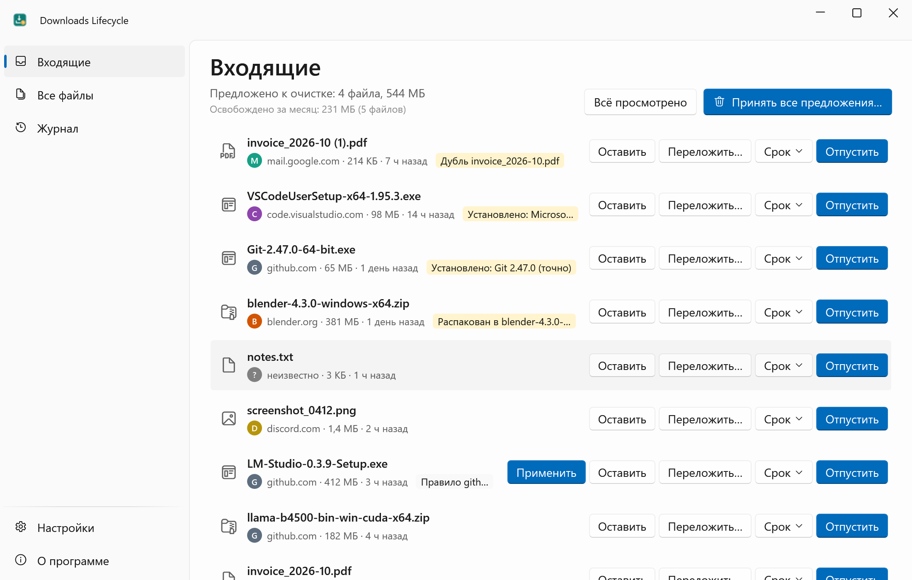
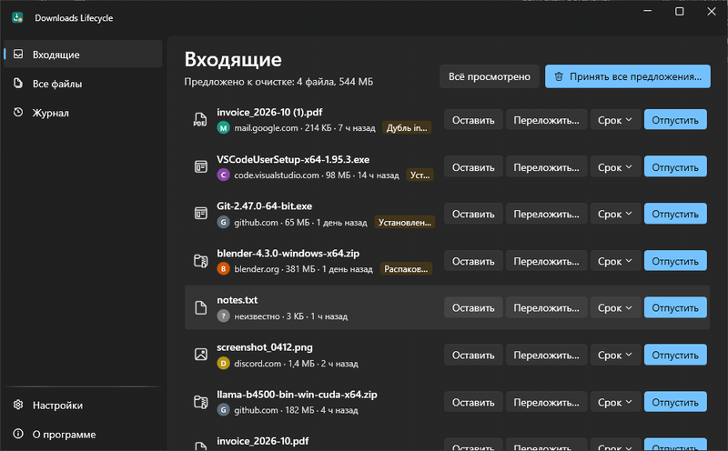
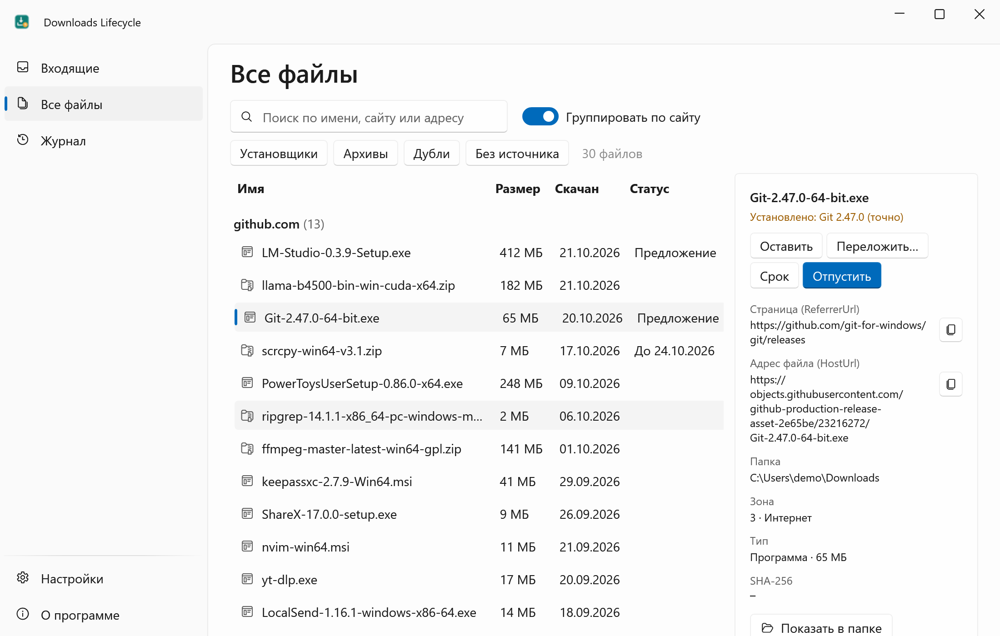
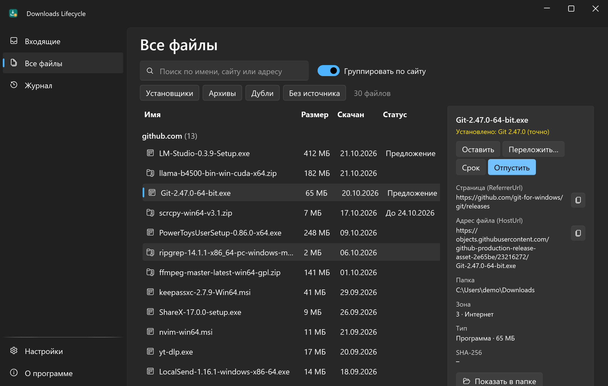
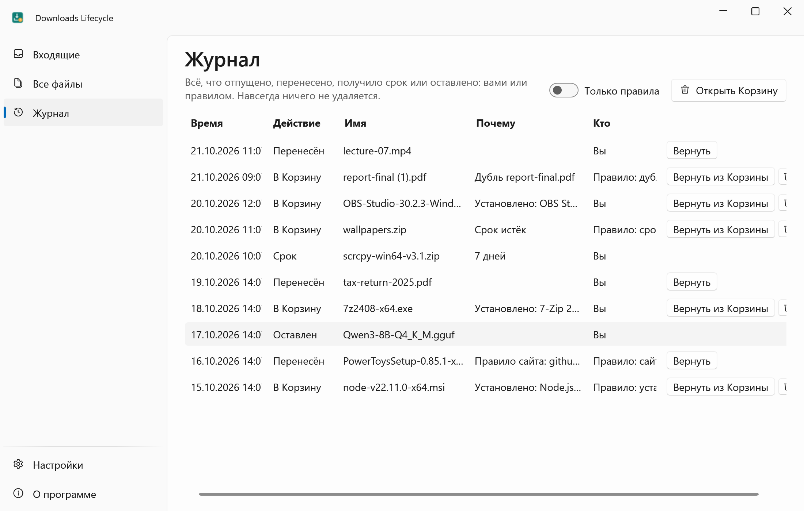
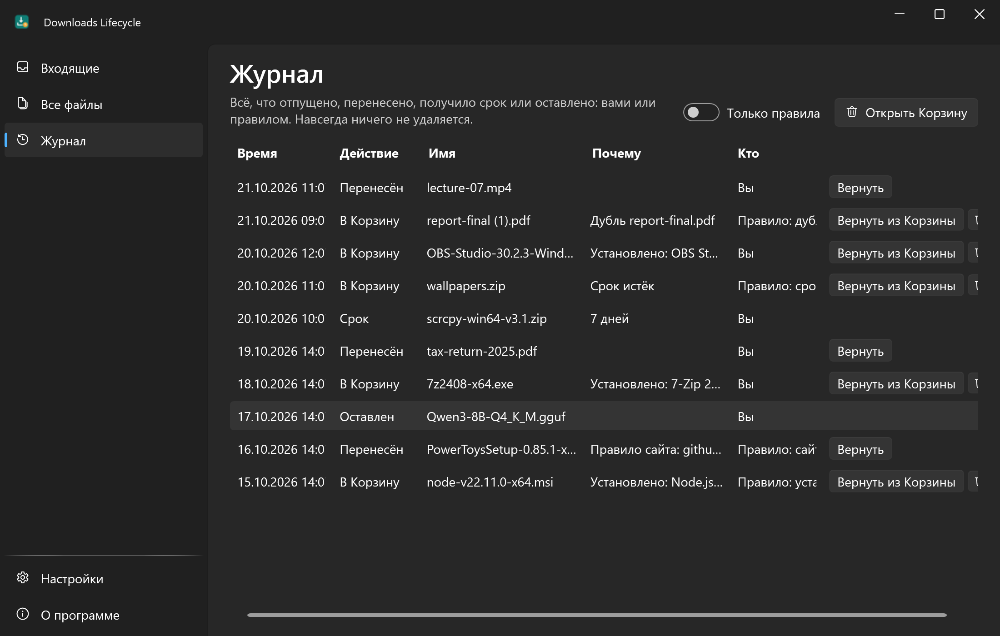
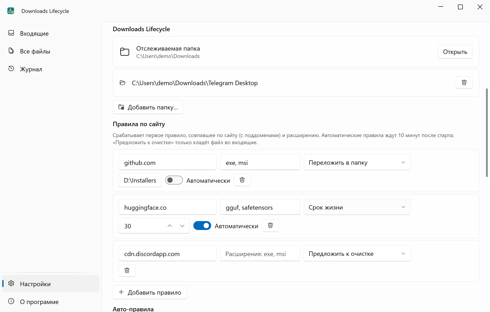
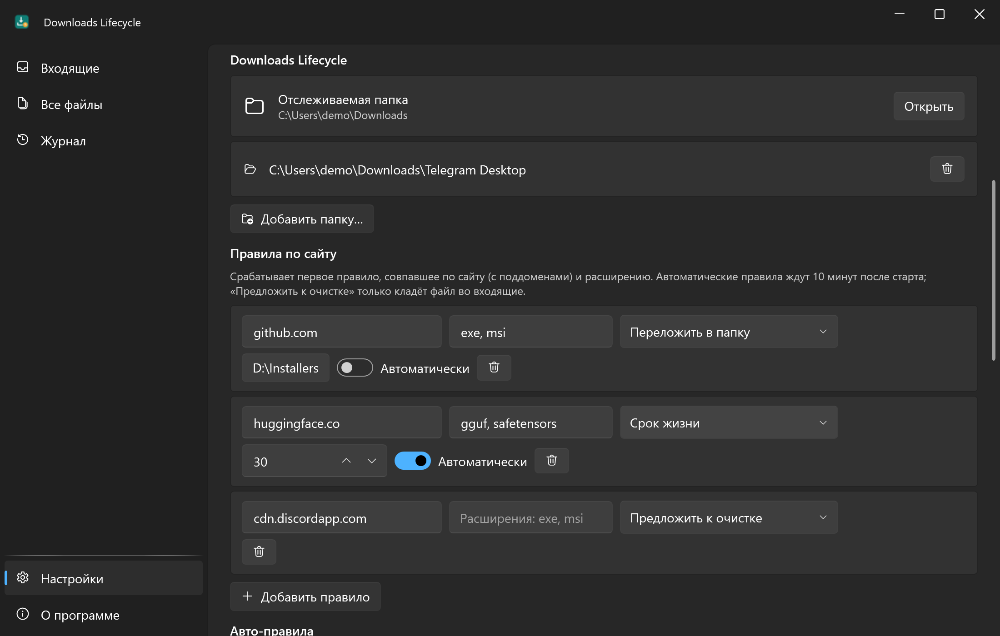
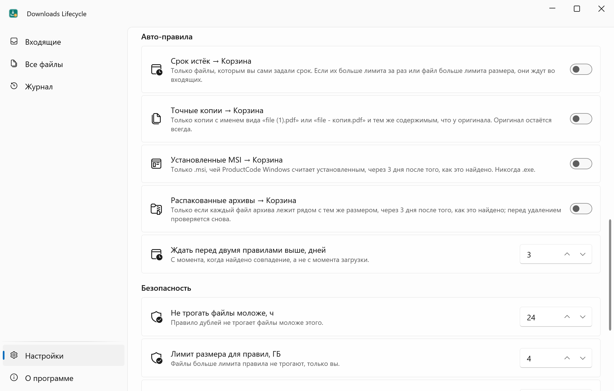
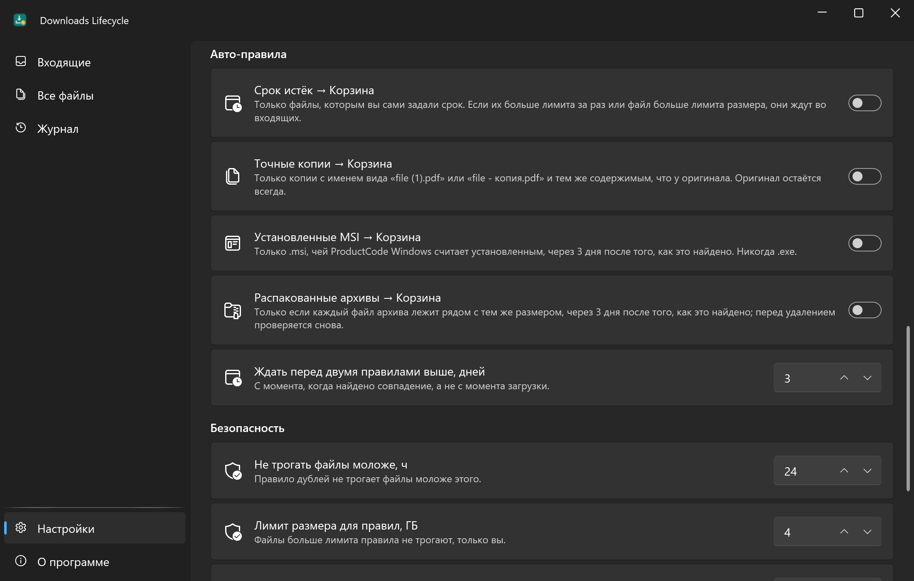

<div align="center">


# Downloads Lifecycle

**«Загрузки» как входящие: файл помнит свой сайт, остатки уходят в Корзину.**

[English](README.md) · **Русский**

[](https://github.com/lojekq/DownloadsLifecycle/releases/latest)
[](https://github.com/lojekq/DownloadsLifecycle/releases)
[](https://github.com/lojekq/DownloadsLifecycle/actions/workflows/ci.yml)

[](LICENSE)

<picture>
  <source media="(prefers-color-scheme: dark)" srcset="docs/inbox-dark-ru.png">
  
</picture>
</div>

## Зачем

Папка «Загрузки» растёт бесконечно: установщики, запущенные полгода назад, давно распакованные архивы, `invoice (1).pdf` рядом с `invoice.pdf`.
Downloads Lifecycle превращает её во входящие: помнит, откуда пришёл каждый файл, находит то, что уже не нужно, и даёт убрать это разом.
Навсегда ничего не удаляется: файлы уходят только в Корзину, а каждое действие записано в журнал.

## Возможности

- **У каждого файла виден сайт, с которого он пришёл** — поиск и группировка по сайту, полный адрес страницы и файла в один клик.
- **Остатки находятся сами** — установщики уже установленных программ, распакованные архивы, дубли вида `file (1).pdf`.
- **Срок жизни** — правый клик → «Срок жизни → 7 дней», и в свой срок файл уходит в Корзину.
- **Правила по сайту** — «github.com + exe, msi → переложить в D:\Installers», «huggingface.co → 30 дней»: автоматически или одной кнопкой «Применить» во входящих.
- **Не только zip** — проверяются и архивы .7z, .rar, .tar.*; папку Telegram Desktop или любую другую можно отслеживать как «Загрузки».
- **Возврат и «Откуда этот файл?»** — журнал возвращает файлы из Корзины; правый клик по любому файлу показывает его сайт и адреса.
- **Один экран в день** — новые загрузки и предложения в одном месте: Оставить, Переложить, Отпустить или Срок, клавиши K / M / Del / T.
- **Безопасность по устройству** — только Корзина, 8 секунд на отмену, всё в журнале, все авто-правила выключены, пока вы их не включите.
- **Всё локально** — без прав администратора, без телеметрии, без чтения истории браузера.

## Как это выглядит



## Скриншоты

| | Светлая | Тёмная |
|---|---|---|
| Все файлы по сайтам |  |  |
| Журнал |  |  |
| Папки и правила по сайту |  |  |
| Авто-правила и безопасность |  |  |

## Как это работает

Когда браузер сохраняет файл, Windows прикрепляет к нему скрытый поток Mark-of-the-Web (`Zone.Identifier`) с адресом страницы и файла.
Downloads Lifecycle только читает его, один раз, при появлении файла, поэтому источник не теряется после «Разблокировать». Установщики сверяются со списком
установленных программ (`.msi` точно, по ProductCode), архивы (`.zip`, `.7z`, `.rar`, `.tar.*`, только их списки файлов) с файлами рядом,
дубли по SHA-256. Всё это происходит на вашем ПК.

## Скачать

1. Скачайте **`DownloadsLifecycle-x.y.z-win-x64.exe`** из [Releases](https://github.com/lojekq/DownloadsLifecycle/releases/latest). Один файл, без установки и без прав администратора.
2. Сборка поменьше: `DownloadsLifecycle-x.y.z-win-x64-fd.zip` (нужен [.NET Desktop Runtime 10](https://dotnet.microsoft.com/download/dotnet/10.0)).
3. Проверка по желанию: `gh attestation verify <файл> -R lojekq/DownloadsLifecycle` или сверка с `SHA256SUMS.txt`.

Требования: Windows 11 x64. Windows 10 22H2 должна работать, но не тестируется.

## Первый запуск

Сначала положите exe в `%LOCALAPPDATA%\Programs\DownloadsLifecycle\`: оттуда программа сама добавит пункт в контекстное меню и ярлык в «Пуск».
При первом запуске Windows может показать предупреждение SmartScreen (см. «Вопросы»). Первый экран покажет, сколько файлов найдено, и предложит два авто-правила, оба выключены.
Дальше программа живёт в трее; включите **Запускать вместе с Windows** в настройках, чтобы получать ежедневное напоминание.

## Настройки

| Настройка | По умолчанию | Что делает |
|---|---|---|
| Срок истёк → Корзина | выкл | Файлы, которым вы сами задали срок, уходят в Корзину, когда он истёк |
| Точные копии → Корзина | выкл | Только `file (1).pdf` / `file - копия.pdf` с тем же содержимым, что у оригинала; оригинал остаётся |
| Установленные MSI → Корзина | выкл | Только `.msi`, чей ProductCode Windows считает установленным; никогда `.exe` |
| Распакованные архивы → Корзина | выкл | Только если каждый файл архива лежит рядом с тем же размером; перед удалением проверяется снова |
| Ждать перед двумя правилами выше | 3 дня | Считается с момента, когда найдено совпадение |
| Правила по сайту | нет | Сайт (с поддоменами) + расширения → срок, перенос в папку или предложение к очистке; автоматически или кнопкой «Применить» |
| Дополнительные папки | нет | Отслеживаются как «Загрузки», например `Загрузки\Telegram Desktop` |
| Не трогать файлы моложе | 24 ч | Правило дублей не трогает более свежие файлы |
| Лимит размера для правил | 4 ГБ | Файлы больше лимита правило не трогает, только вы |
| Спрашивать, если сразу истекает больше | 20 | После отпуска они ждут во входящих вашего подтверждения |
| Ежедневное напоминание | вкл, 19:00 | «Во входящих 12 файлов, к очистке 3,4 ГБ»; не во время полноэкранной игры или презентации |
| «Срок жизни» в контекстном меню | вкл, если exe лежит в `%LOCALAPPDATA%\Programs\DownloadsLifecycle\` | В Windows 11 пункт находится в **Показать дополнительные параметры** (Shift+F10) |
| Язык, тема, автозапуск, ярлык в «Пуск», обновления | как в Windows / выкл / вкл | Как обычно |

Настройки, индекс (`state.json`) и журнал (`journal.jsonl`) лежат в `%APPDATA%\DownloadsLifecycle`.

## Безопасность

- Только Корзина, никакого безвозвратного удаления. Если файл в Корзину не помещается (слишком большой, сетевой диск), Windows сначала спросит; съёмные и сетевые диски программа не трогает вовсе.
- Перед каждым действием файл проверяется заново: тот же файл, тот же размер и дата, не открыт в другой программе. Иначе действие отменяется.
- `.exe`, не совпавший ни с одной установленной программой, никогда не предлагается: это может быть портативная программа.
- Перенос на другой диск: копия, сверка, и только потом оригинал уходит в Корзину; перенос можно вернуть из журнала.
- Правила ждут 10 минут после старта, их можно приостановить из трея, и они пропускают файлы больше лимита.
- Установщики и архивы правило отпускает только при точном совпадении (MSI по ProductCode, архив на 100 %), через несколько дней после того, как оно найдено, и перед этим проверяет снова.
- Если Контроль памяти Windows тоже чистит «Загрузки», настройки предупредят: такие файлы идут мимо Корзины и журнала.

## Вопросы

<details><summary>«Система Windows защитила ваш компьютер» / предупреждение SmartScreen</summary>

У exe пока нет цифровой подписи, поэтому Windows не знает издателя. Нажмите **Подробнее → Выполнить в любом случае**.
Каждый файл собирает GitHub Actions из этого репозитория; проверить его можно через `gh attestation verify` или `SHA256SUMS.txt`.
Если включён Smart App Control, он блокирует неподписанные файлы без возможности разрешить отдельный; остаётся только выключить его.
</details>

<details><summary>Антивирус ругается</summary>

Это ложное срабатывание: у программы нет установщика, упаковщика и обфускации; файлы в Корзину она отправляет только по вашей команде.
Сообщите об этом производителю антивируса и откройте issue с названием детекта и SHA256 файла.
</details>

<details><summary>В контекстном меню нет «Срок жизни»</summary>

Windows 11 показывает пункты классических программ в **Показать дополнительные параметры** (или Shift+F10). Пункт появляется сам, только если exe
лежит в `%LOCALAPPDATA%\Programs\DownloadsLifecycle\`; иначе включите его в настройках. Срок работает только для файлов в «Загрузках».
</details>

<details><summary>Почему источник «неизвестно»?</summary>

Сайт известен, только если браузер записал Mark-of-the-Web: у приватных окон, Telegram, файлов с флешки или не-NTFS диска и файлов,
разблокированных до первого запуска программы, его нет. Всё остальное для них работает.
</details>

<details><summary>Файл ушёл в Корзину по ошибке</summary>

«Журнал» → **Вернуть из Корзины**: файл вернётся на прежнее место (если оно свободно). У переносов есть **Вернуть**.
</details>

<details><summary>Как удалить программу?</summary>

«О программе» → **Удалить данные и автозапуск** (заодно снимается пункт контекстного меню), затем удалите exe.
</details>

## Приватность

Телеметрии нет. Единственный сетевой запрос — проверка обновлений: `GET https://api.github.com/repos/lojekq/DownloadsLifecycle/releases/latest` раз в сутки; выключается в настройках.
Локально программа читает верхний уровень «Загрузок», потоки `Zone.Identifier` этих файлов, список установленных программ и файлы `.msi` (только чтение).
Пишет только в `%APPDATA%\DownloadsLifecycle` и в свои ключи контекстного меню; в логах нет имён файлов, путей и адресов.

## Сборка из исходников

```powershell
winget install Microsoft.DotNet.SDK.10
git clone https://github.com/lojekq/DownloadsLifecycle
cd DownloadsLifecycle
dotnet run --project src/DownloadsLifecycle -- --watch-dir C:\Demo\Downloads
dotnet test
```

Debug-сборка не трогает настоящие «Загрузки»: она следит за `C:\Demo\Downloads` или за папкой из `--watch-dir`.

## Лицензия

MIT © 2026 lojekq
